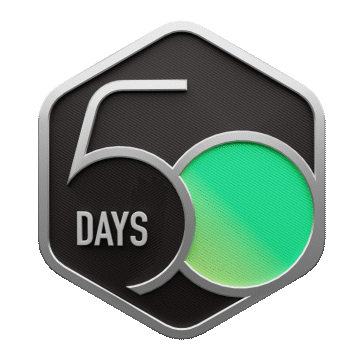
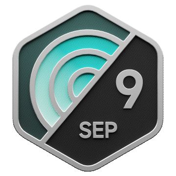
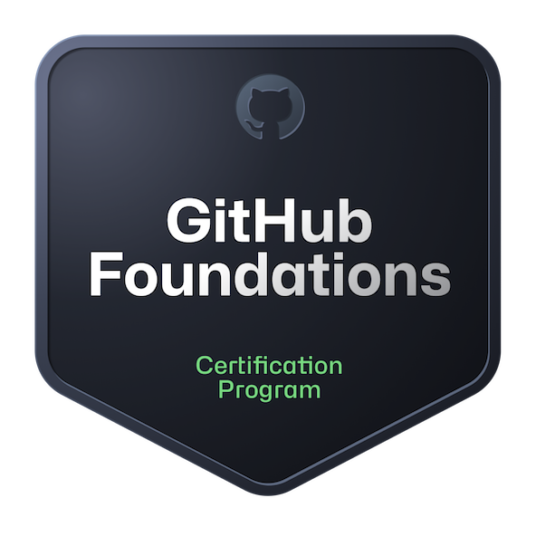
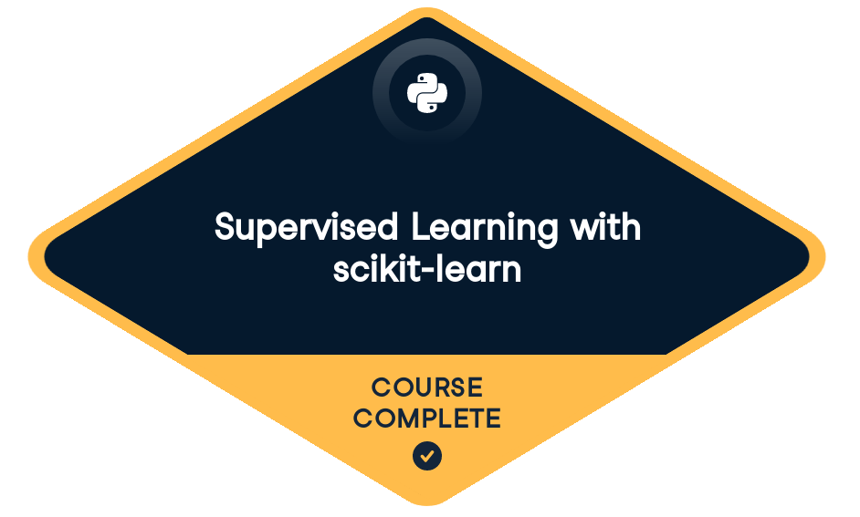

 

&nbsp;&nbsp;&nbsp;

 

## ⚡ About

I'm a final-year **B.E. student in AI & Data Science** from Pune, India. I ship production-grade products end-to-end: agentic LLM pipelines, REST APIs, React/Next.js frontends, and the cloud they run on.

My products have real, active users in several countries, including AI agents, a bilingual news platform, and a published Chrome extension.

- 🛠️ **Now:** AI Engineer Intern @ [Compucom](https://www.compucom.com), building and shipping AI features on a distributed international team
- 🎯 **Looking for:** founding-engineer and AI/ML roles
- 🏆 **Wins:** 1st place, DevClash 2025 · 2nd runner-up, TechNavinya 2025

## 🧰 Tech stack

<table>
  <tr>
    <td align="center" width="50%"><b>Languages</b>  </td>
    <td align="center" width="50%"><b>Frameworks</b>  </td>
  </tr>
  <tr>
    <td align="center"><b>Databases</b>  </td>
    <td align="center"><b>Cloud & DevOps</b>  </td>
  </tr>
</table>

## 📊 GitHub activity

  
  
    
  
    
  

## 🏅 Badges & certifications

  
  &nbsp;&nbsp;&nbsp;&nbsp;&nbsp;&nbsp;
  
     
  
  &nbsp;&nbsp;&nbsp;&nbsp;&nbsp;&nbsp;&nbsp;&nbsp;
  
    
  
  &nbsp;&nbsp;&nbsp;&nbsp;&nbsp;&nbsp;&nbsp;&nbsp;
  

 

  

